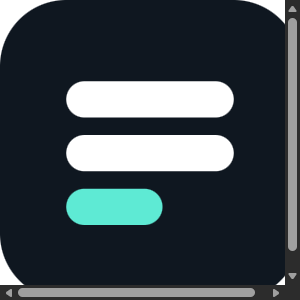
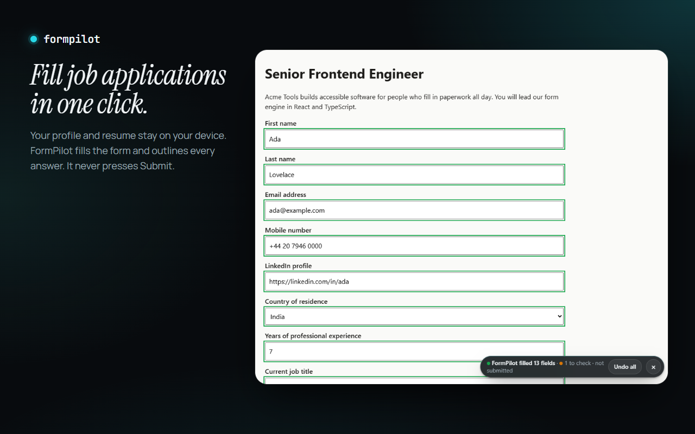
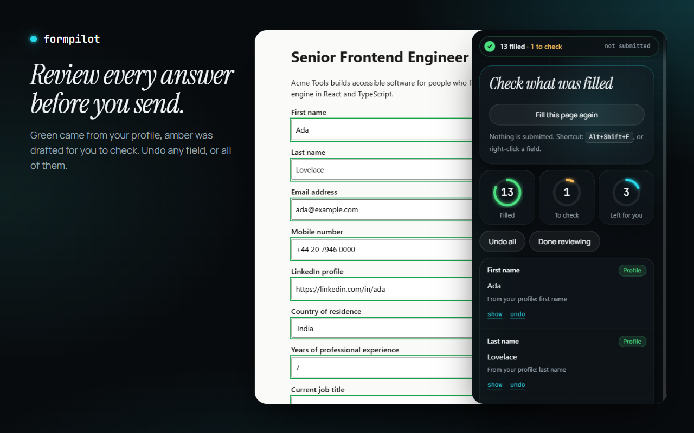

<p align="center">
  
</p>

<h1 align="center">FormPilot AI</h1>

<p align="center">
  Fill job applications and web forms in one click, from a profile you keep on your own device.<br>
  A Manifest V3 browser extension for Microsoft Edge and Google Chrome.
</p>

<p align="center">
  
  
  
</p>

---

## Where it's available

| Store | Status |
|---|---|
| **Microsoft Edge Add-ons** | Submitted on 24 November 2026, **in review** by Microsoft (usually up to 7 business days). The store link will be added here once it's approved. |
| Chrome Web Store | Not submitted yet. The same package works in Chrome; see [Install from source](#install-from-source). |

## What it does

FormPilot reads the visible fields of the form you're on, fills them from your saved profile and resume, and can draft short answers to open questions like "Why do you want to join?". Every value is outlined on the page and listed in FormPilot so you can review it. **It never presses Submit.**

<p align="center">
  
</p>

- **Your data stays in your browser.** No account, no tracking, no server of ours.
- **Three ways to fill:**
  - **Basic** (free): rules match your profile to the form, entirely on your device.
  - **On-device AI** (free): the AI model built into your browser answers what the rules can't place. No key, and nothing leaves your device.
  - **Claude**: with your own Anthropic API key, Claude drafts answers to open questions. You pay Anthropic directly for what you use.
- **Works on real-world forms:** sites built with React, Angular and Vue, Google Forms (dropdowns, checkboxes, dates), Greenhouse-style application pages and plain HTML, including forms inside same-site frames.
- **Built for Indian applications too:** Class 10 and 12 boards, years and marks (read from your resume if not saved), District, PIN code, and Aadhaar. Your Aadhaar number is filled only if you saved it, and is never sent anywhere.
- **Review and undo:** a green outline means the value came from your profile, amber means it was drafted for you to check. You can undo any field, or all of them.
- **Safe by default:** skips passwords, payment cards, bank and passport numbers, CAPTCHAs, hidden fields, consent boxes and personal demographic questions.
- **Out of your way:** a popup from the toolbar that can move into the side panel, the **Alt+Shift+F** shortcut, or right-click a field and choose **Fill this form with FormPilot**.

<p align="center">
  
</p>

## Privacy

FormPilot has no backend. Your profile, resume and settings live in the browser's extension storage. In Basic and On-device AI modes nothing leaves your device. In Claude mode, a fill you ask for sends one request straight from your browser to `api.anthropic.com` with your own key. Read the full [privacy policy](PRIVACY.md).

## Install from source

```bash
npm install
npm run build          # typecheck + build into dist/
```

1. Open `edge://extensions` (or `chrome://extensions`) and turn on **Developer mode**.
2. Click **Load unpacked** and pick the `dist` folder.
3. Click the FormPilot icon in the toolbar, add your details on the **Profile** tab, open any form, and press **Fill this page**.

Requires Edge or Chrome 116 or newer. On-device AI needs a browser that ships a built-in model.

## Development

| Command | What it does |
|---|---|
| `npm run build` | Typecheck and build the extension into `dist/` |
| `npm test` | 74 unit tests (vitest) |
| `npm run e2e` | 87 end-to-end checks: the real extension in headless Edge filling React and Google Forms-style pages, importing PDF and Word resumes, and the popup |
| `npm run harness` | The panel in a normal tab with a `chrome.*` stand-in at http://localhost:5174 (`?popup`, `?w=600` and `?w=full` change the frame) |
| `npm run package` | Store checks, then `release/formpilot-ai-<version>.zip` for both stores |
| `npm run store-assets` | Store screenshots, promo tile and logo into `store/` (run `npm run e2e` first) |
| `npm run icons` | Render the toolbar icons from `scripts/logo.mjs` |

**Built with** React 19, TypeScript, Tailwind CSS v4, Vite and CRXJS, Zod, pdf.js, the Anthropic TypeScript SDK and the browser's Prompt API.

## Docs

- [Testing it yourself](docs/TESTING.md)
- [Publishing to Edge Add-ons and the Chrome Web Store](docs/STORE_SUBMISSION.md)
- [Architecture and folder structure](docs/ARCHITECTURE.md)
- [Data and API schemas](docs/SCHEMAS.md)
- [Design system](docs/DESIGN.md)
- [Project log](docs/PROJECT_LOG.md): what was built, decided, verified and fixed

## Support

Found a bug or have a question? [Open an issue](https://github.com/oyeshaurya/formpilot-ai/issues).
